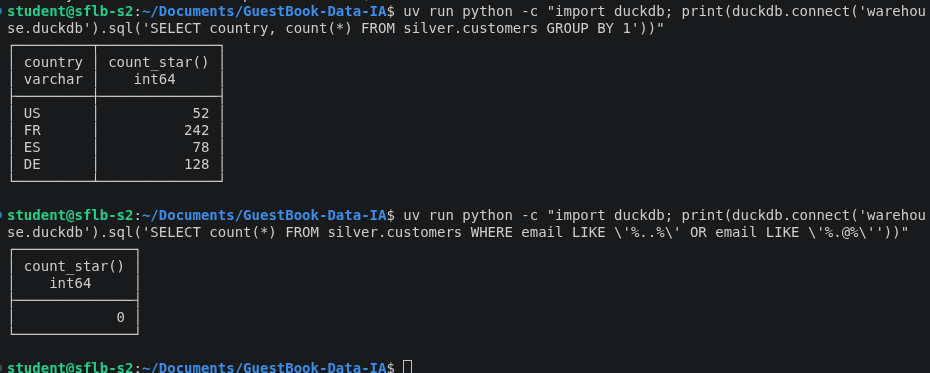

# Apprentissages

## Transform & Normalize → Silver

On réalise un versionning de dump de BDD MAIS on modifie les données NON PAS depuis un export mais depuis la version Bronze faite en amont; ainsi on uniformise les tables selon les normes dans la nouvelle version Silver.

### Problème rencontré et pourquoi il est survenu
J'ai eu un peu de mal à réaliser les requetes SQL pour le fichier pipelines/transform.py .

### Solution appliquée et pourquoi cette solution fonctionne
J'ai demandé de l'aide à mon voisin de droite qui est nul autre que Remy LIM et ça a fonctionné car il est très perspicace et talentueux.

### Ce que j'ai appris
J'ai appris à créer une version Silver avec un script de pipeline et d'operer des manipulations.

```
uv run python pipelines/transform.py
```

```
uv run python -c "import duckdb; print(duckdb.connect('warehouse.duckdb').sql('SELECT count(*) FROM silver.orders'))"
```

```
uv run python -c "import duckdb; print(duckdb.connect('warehouse.duckdb').sql('SELECT count(*) FROM silver.customers'))"
```

